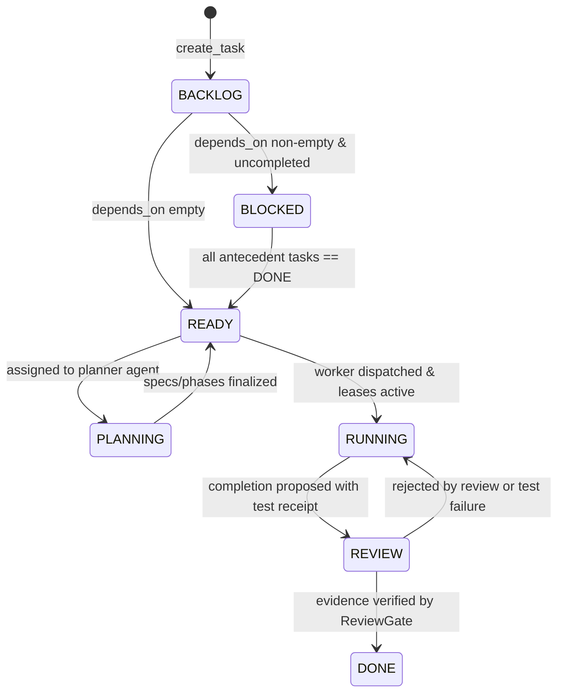
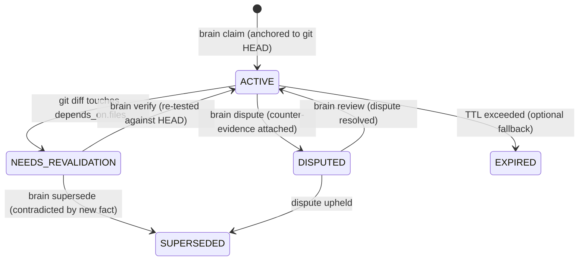

```mermaid
stateDiagram-v2
    [*] --> REQUESTED: brain start / brain reserve
    REQUESTED --> DENIED: target file held by another active lease
    REQUESTED --> ACTIVE: all files uncontested; advisory lock granted
    ACTIVE --> RELEASED: explicitly closed via brain end with session summary
    ACTIVE --> EXPIRED: worker heartbeat or lease duration timed out
```

# Formal State Machines (FSMs)

**Document Version:** 1.0.0  
**Authority:** Local Agent Control Plane  
**Governing Invariant:** INV-007 (Validated State Machine Transitions)

---

## 1. Task Lifecycle FSM

The Task Finite State Machine governs the lifecycle of work cards from creation to completion. Unlike a flat Kanban board, state transitions are strictly directional and depend on prerequisite completion and verified execution receipts.

### A. State Diagram

### B. State Definitions
* `BACKLOG`: Newly created task card; pending dependency evaluation.
* `BLOCKED`: Task has one or more antecedent dependencies in `depends_on` that are not yet `DONE`.
* `READY`: All antecedent dependencies are `DONE`; task is actionable for scheduling and lease acquisition.
* `PLANNING`: Optional stage for complex architecture/spec decomposition.
* `RUNNING`: Worker agent actively executing under an uncontested lease.
* `REVIEW`: Work completed; awaiting review gate verification and evidence checks.
* `DONE`: Terminal state; backed by immutable execution record and review receipt.

### C. Permitted Transition Matrix

| From State | Allowed Target States | Required Guard / Condition |
|---|---|---|
| `BACKLOG` | `BLOCKED`, `READY` | Evaluated against dependency graph. |
| `BLOCKED` | `READY` | Triggered automatically when all prerequisites reach `DONE`. |
| `READY` | `PLANNING`, `RUNNING` | Must assign agent; must acquire uncontested leases for `files`. |
| `PLANNING` | `READY`, `RUNNING` | Spec produced or phases updated. |
| `RUNNING` | `REVIEW`, `READY` | Proposed completion requires attached execution receipt; or abort. |
| `REVIEW` | `DONE`, `RUNNING` | `DONE` requires `ReviewGate` pass; rejection returns to `RUNNING`. |
| `DONE` | *(none - terminal)* | Reopening requires explicit human authorization or new task ID. |

---

## 2. Claim Lifecycle FSM

The Claim Finite State Machine governs the temporal validity of recorded engineering facts. It ensures knowledge decays safely when underlying code is modified, preventing agents from building upon stale assumptions.

### A. State Diagram

### B. State Definitions
* `ACTIVE`: Fully valid, verified engineering fact anchored to `verified_commit`. Injected into prompt briefs and available in default `brain recall`.
* `NEEDS_REVALIDATION`: One or more files in `depends_on.files` have been modified in Git since `verified_commit`. Withheld from standard recall; flagged with warning in audit.
* `SUPERSEDED`: Factually superseded or contradicted by a newer claim (`superseded_by`). Retained in history for auditability; never injected into active prompts.
* `DISPUTED`: An agent or human has flagged contradictory evidence against this claim.
* `EXPIRED`: Time-to-live expired without active review (legacy compatibility).

### C. Permitted Transition Matrix

| From State | Allowed Target States | Trigger / Condition |
|---|---|---|
| `(initial)` | `ACTIVE` | `brain claim` with `verified_commit` hash. |
| `ACTIVE` | `NEEDS_REVALIDATION` | Git diff scanner detects changes in `depends_on.files`. |
| `ACTIVE` | `DISPUTED` | `brain dispute` with counter-evidence. |
| `NEEDS_REVALIDATION` | `ACTIVE` | `brain verify` confirms claim remains true at new `HEAD`. |
| `NEEDS_REVALIDATION` | `SUPERSEDED` | `brain supersede` links replacing claim ID. |
| `DISPUTED` | `ACTIVE` | `brain review` resolves dispute in favor of claim. |
| `DISPUTED` | `SUPERSEDED` | `brain review` resolves dispute against claim. |

---

## 3. Lease Lifecycle FSM

The Lease Finite State Machine governs resource concurrency over filesystem paths.

### A. State Diagram

### B. State Definitions
* `REQUESTED`: Ephemeral state while `LeaseManager` inspects target paths.
* `DENIED`: Request refused due to `LeaseConflict`. Calling agent must wait or reschedule.
* `ACTIVE`: Files locked exclusively to holder session; writes permitted by `brain guard`.
* `RELEASED`: Orderly release of files; handoff or test status recorded.
* `EXPIRED`: Session abandoned or sweep timed out; locks automatically reclaimed.

### C. Permitted Transition Matrix

| From State | Allowed Target States | Trigger / Condition |
|---|---|---|
| `(initial)` | `REQUESTED` | Agent calls `start` or `reserve` specifying `--files`. |
| `REQUESTED` | `DENIED` | Any file matches an existing `ACTIVE` lease. |
| `REQUESTED` | `ACTIVE` | All files uncontested; lease token issued. |
| `ACTIVE` | `RELEASED` | `brain end` called with session summary. |
| `ACTIVE` | `EXPIRED` | Wall-clock exceeds `lease_expires` or `sweep` reaps stale session. |
